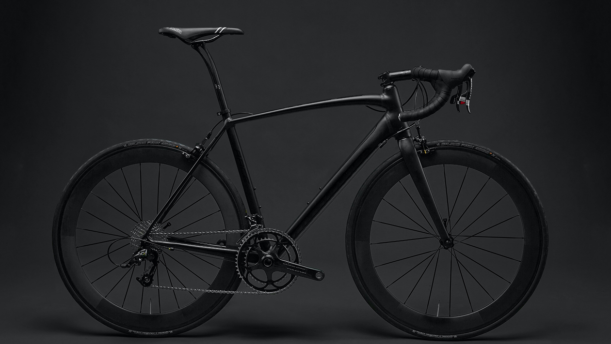

# MyBIKE

A responsive bicycle landing page built from a Figma design.

**[Live Demo](https://artmay777.github.io/mybike-landing-page/)** · **[Figma Design](https://www.figma.com/file/NZQAIydtHo5QkINyGLHNcq/BIKE-New-Version?node-id=0%3A1)**



## About the Project

MyBIKE presents bicycle models, their prices and key features through a clean, responsive interface.

The project focuses on translating a Figma design into a working website using HTML, SCSS and the BEM naming methodology.

## Technologies


## Features

- Responsive layouts for desktop, tablet and mobile screens.
- Slide-in mobile navigation menu.
- Bicycle cards with specifications and prices.
- Product detail galleries with hover effects.
- Smooth scrolling between page sections.
- Contact form layout and clickable phone and email links.
- Scalable SVG favicon.

## Getting Started

### Prerequisites

Install Node.js and npm before running the project.

### Installation

```bash
git clone https://github.com/ArtMay777/mybike-landing-page.git
cd mybike-landing-page
npm install
```

### Run locally

```bash
npm start
```

Open the local address shown in your terminal.

### Build for production

```bash
npm run build
```

### Check code quality

```bash
npm run lint
```

## Project Structure

```text
src/
├── images/       Images, logos and icons
├── scripts/      JavaScript entry point
├── styles/       SCSS styles
└── index.html    Page markup
```

## Author

[Artem Maiboroda](https://github.com/ArtMay777)
